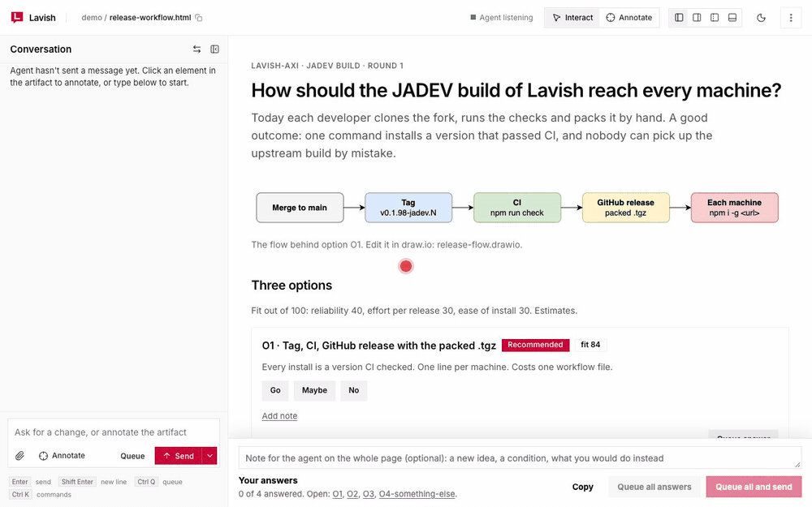
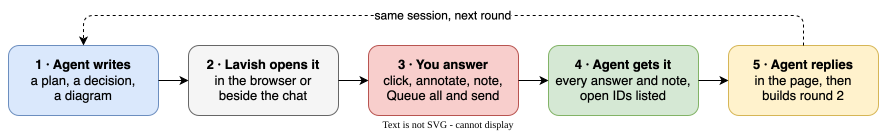

<!-- Portions copyright (c) 2026 JADEV-CORP. MIT License, see LICENSE. -->
<h1 align="center">Lavish</h1>

<p align="center"><b>Your agent asks on a page. You answer in one click. It gets every answer.</b></p>

<p align="center">
  <a href="https://www.npmjs.com/package/@jadev-corp/lavish"></a>
  
  
  <a href="https://github.com/kunchenguid/lavish-axi"></a>
</p>

<p align="center">
  
</p>

Coding agents write long answers in a terminal. Decisions get lost in scrollback, and "what do you think of options 2 and 4?" turns into a chat of its own.

Lavish puts the answer on a page instead. Your agent writes HTML (a plan, a set of decisions, a review, a diagram), Lavish opens it, and you answer it the way you would a good form: pick options, write notes, point at anything on the page. One click sends everything back, and the agent picks it up in the same session.

A page can also stay in use, like your own Artifacts, kept on your machine. It starts from a template, remembers what you enter, asks the agent and shows the reply, takes the files you pick and saves the ones it makes, and keeps every version. The gallery lists every page you opened.

The recording above is real: [demo/release-workflow.html](demo/release-workflow.html) on a live Lavish server, driven by [scripts/record-demo.js](scripts/record-demo.js).

<p align="center"></p>

## Install

Node 22 or later.

```sh
npm i -g @jadev-corp/lavish
lavish --version
lavish setup plugin    # optional: register it with VS Code, Cursor and Copilot CLI
```

To try it without installing anything: `npx -y @jadev-corp/lavish --help`.

`lavish-axi` still works as an alias for `lavish`, so agents, hooks and skills written for it keep working. Coming from the 0.1.x tarball? Run `npm rm -g lavish-axi` first: both packages provide the `lavish-axi` command.

Update with `lavish update`. `lavish update --check` only reports. Open reviews also show **Update** in the top bar when a newer version is on npm.

For diagrams, install the [draw.io desktop app](https://github.com/jgraph/drawio-desktop/releases) (open source): `brew install --cask drawio` on macOS, `winget install JGraph.Draw` on Windows.

## Try it

```sh
lavish demo/release-workflow.html        # opens the page from the recording
lavish poll demo/release-workflow.html   # what your agent runs to receive your answers
```

Or start your own page from a template:

```sh
lavish new tracker                       # writes .lavish/tracker-<date>.html
lavish .lavish/tracker-<date>.html       # opens it
```

Then ask your agent for anything easier to judge on a page than in a terminal: "put the three options on a Lavish page", "review this plan with me in Lavish", "make me a tracker for the launch". The agent reads current instructions from the CLI itself (`lavish --help`, `lavish new`, `lavish playbook`), so they never go stale.

## What this build adds

This is the JADEV build of [lavish-axi](https://github.com/kunchenguid/lavish-axi) by Kun Chen. Everything upstream does still works; these are the additions.

|                      |                                                                                                                                                                                              |
| -------------------- | -------------------------------------------------------------------------------------------------------------------------------------------------------------------------------------------- |
| **Templates**        | `lavish new` writes a ready page: `decision`, `brainstorm`, `dashboard`, `report`, `tracker` or `slides`. The agent fills it in instead of starting from a blank file.                       |
| **Queue all**        | Every page with questions ends with one bar: how many you answered, links to the open ones, **Copy**, **Queue all** and **Queue all and send**. The agent never has to remember to build it. |
| **Notes everywhere** | A note for the whole page, and an **Add note** on every question that has no text box. Notes are multi-line, ride on the answer they belong to, and survive a reload.                        |
| **Copy that works**  | Copy writes from inside your click and through the review window, and shows the text selected when the browser still refuses, so pasting into a chat always works.                           |
| **Pages remember**   | A page keeps what you enter (a checklist, a table, a draft) through reloads and restarts. The agent reads it with `lavish data`.                                                             |
| **Ask the agent**    | A button on the page asks the agent a question and shows the reply when it comes. With no agent listening, the page says so.                                                                 |
| **Files in and out** | Pick images, PDFs or text files for the agent to read, and save a CSV or any other file the page makes.                                                                                      |
| **Versions**         | Every saved change of a page is kept. View any version, compare two by text or HTML, and restore one after a confirmation. Agents use `lavish versions`.                                     |
| **Gallery**          | `lavish` at a terminal, or the server's root URL, lists every page you opened: title, folder, last change, status, search and pins. One click reopens a page.                                |
| **draw.io diagrams** | `lavish diagram flow.drawio` renders a static SVG that follows light and dark mode, keeps the diagram editable in draw.io, and gives the agent a preview to check before you see it.         |
| **Beside the chat**  | In T3 Code the review opens in the thread's preview panel, and in VS Code's Copilot chat in the integrated browser, instead of a separate window.                                            |
| **Brainstorms**      | `lavish playbook brainstorm` shapes a thinking session: the problem, a diagram, three to five real options, Go / Maybe / No with notes, and numbered rounds.                                 |

## Inside T3 Code and VS Code

In T3 Code, Lavish tells the agent to open the review with T3's `preview_open` tool, in the thread's own preview panel. In VS Code, add this to your settings once, and Copilot's agent chat opens reviews in the integrated browser beside the chat:

```json
"terminal.integrated.env.osx": { "LAVISH_AXI_OPEN": "panel" }
```

Use `terminal.integrated.env.windows` or `.linux` on those systems. `lavish <page> --external` always opens your regular browser.

## Privacy

Pages, answers, notes, stored page data and versions stay on your machine, in `~/.lavish-axi`. This build sends no telemetry. Its only outside call is a version check against the npm registry, which `LAVISH_AXI_UPDATE_CHECK=0` turns off. Sharing a page on the web is a separate, explicit command (`lavish share`).

## More

- [docs/jadev-fork.md](docs/jadev-fork.md): what this build changes, versions, releases, and how it follows upstream.
- [docs/upstream-readme.md](docs/upstream-readme.md): the full guide (annotation, whiteboards, CLI reference, sharing).
- [CHANGELOG.md](CHANGELOG.md): what changed in each version.

From source:

```sh
git clone https://github.com/JADEV-CORP/lavish-axi && cd lavish-axi
pnpm install && pnpm run check && npm pack
npm i -g ./jadev-corp-lavish-*.tgz
```

## License

MIT. Upstream lavish-axi is copyright Kun Chen; the changes in this build are copyright JADEV-CORP.
